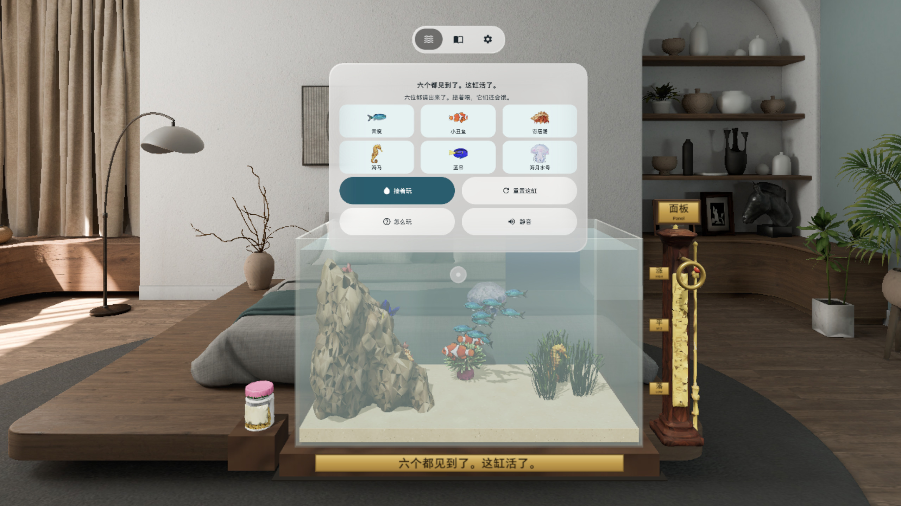
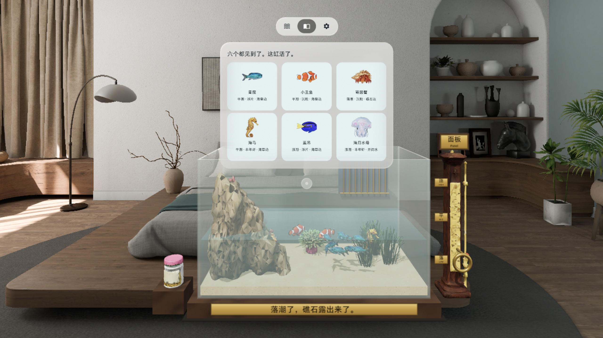
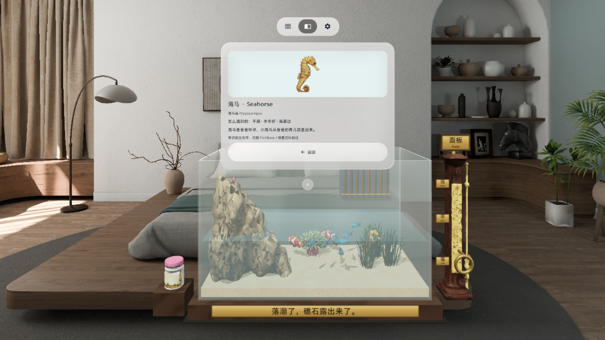
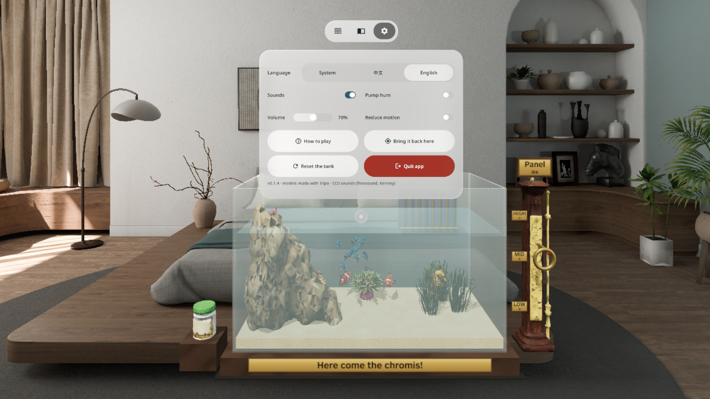

# 潮汐水族 Tide Tank

[中文](#中文) · [English](#english)


## 中文

一只海水缸摆在你正前方（PICO OS 6 Full Space，混合现实 Stage）：缸里有礁石、海葵、海草和一群青魔，缸边立着黄铜潮位柱，罐墩上放着饲料罐，控制窗在缸的上方。手或手柄碰到饲料罐按一下 grip / 扳机拿起来，松手也还在手里（远处用手柄射线或眼手指着按一下也行）；移到水面上翻手腕就倒饲料，转得越多撒得越多，再按一下放回罐墩；也可以直接点沙底撒一小撮。拖黄铜潮位手柄（落 / 平 / 涨三档吸附）或点刻度牌换潮位：落潮礁石露出水面，涨满潮外海的闸门打开。换着饲料和潮位，把缸里藏着的 6 种海洋生物一个个引出来，图鉴记下见过的。

- 缸心离眼 0.88 m、缸沿在眼下 0.14 m，站着坐着平视都能看到整只缸；控制窗 600 × 440 dp，原生 TabBar：水缸 / 图鉴 / 设置
- 三种饲料（浮片 / 沉粒 / 丰年虾）、三档潮位；青魔、小丑鱼、寄居蟹、海马、蓝吊、海月水母各有出场条件
- 手势捏合、眼动 + 捏合、手柄射线；设置里 [叫回面前]，摇杆左右转缸
- 静音、三档音量、水泵声、减少动态、重置、退出；中英双语，全部本机运行，不联网、不需要账号

| | |
|---|---|
|  六个都见到了，图鉴 6/6 |  拿起饲料罐，旁边是「翻手倒食物」提示卡 |
|  撒浮片，青魔冲上来抢食 |  落潮，礁石露出水面 |
|  图鉴：六种生物和出场条件 |  图鉴详情：海马 |

截图来自 PICO 模拟器（v0.1.4）。演示视频是模拟器调试指令驱动的录屏，**非真实手势录像**，没有声音。

### 安装

从 [Release v0.1.4](https://github.com/kejing-dev/TideTank/releases/tag/v0.1.4) 下载 `TideTank-v0.1.4.apk`（`assembleRelease` 未签名包，供 Vibe Lab 平台签名；自己装到头显请用本地 `./gradlew assembleDebug` 的包）：

```
adb install -r TideTank-v0.1.4.apk
pico-cli app launch io.embodit.tidetank
```

### 已知问题

- 在缸口中间倒食时，控制窗会挡住罐子和提示卡；把罐子移到缸口右侧靠边倒能看到
- 手直接拿罐要伸直手臂、身体略前倾（罐墩离肩约 0.8 m）；够不着可以用手柄射线或眼手远程拿
- 演示视频是模拟器调试指令驱动的录屏，非真实手势录像，没有声音

## English

A reef tank right in front of you (PICO OS 6 Full Space, a Mixed Stage): rocks, an anemone, seagrass, a school of chromis,
a brass tide post and a food jar, with the control window above the tank. Touch the jar and press grip or trigger to pick it
up (or point the controller ray / eye-hand at it and press once); it stays in your hand when you let go. Turn your wrist over
the water to pour (more turn, more food), press again to put it back, or tap the sand for a pinch. Drag the brass tide handle
(snaps to low / mid / high) or tap a gauge plate: low tide bares the rocks, high tide opens the sea gate. Mix food and tide to
coax out six hidden creatures and fill the guide.

- Tank centre 0.88 m from the eye, rim 0.14 m under it: the whole tank is in view standing or seated; control window
  600 x 440 dp with a native TabBar (Tank / Guide / Settings)
- Three foods (flakes / pellets / brine shrimp), three tides; chromis, clownfish, hermit crab, seahorse, blue tang and moon
  jelly each have their own conditions
- Hand pinch, gaze + pinch, controller ray; Bring it back here; thumbstick turns the tank
- Mute, volume, pump hum, reduce motion, reset, quit; Chinese and English; fully offline, no account

| | |
|---|---|
|  All six found |  The jar picked up, with its tip |
|  The guide |  Settings |

Screenshots are from the PICO emulator (v0.1.4). The demo video is driven by emulator debug input: **not a recording of
real hand gestures**, and silent.

### Install

Download `TideTank-v0.1.4.apk` from [Release v0.1.4](https://github.com/kejing-dev/TideTank/releases/tag/v0.1.4) (unsigned
`assembleRelease` build for platform signing; for your own headset build `./gradlew assembleDebug`):

```
adb install -r TideTank-v0.1.4.apk
pico-cli app launch io.embodit.tidetank
```

### Known issues

- Pouring over the middle of the tank, the control window hides the jar and its tip; pour near the right edge to see it
- Picking the jar up by hand needs a straight arm and a slight lean (about 0.8 m from the shoulder); the ray or eye-hand
  works from anywhere
- The demo video is driven by emulator debug input, not real hands, and is silent

## Build / credits

Build: see `AGENTS.md`. Package `io.embodit.tidetank`, PICO Spatial SDK 6.1.9, minSdk 35.

Third-party: 3D creatures and props generated with Tripo (the developer's account), decimated / calibrated by
`tools/build_models.py`; sounds are CC0 recordings (freesound.org, Kenney) listed in `tools/make_sounds.py`; Noto Sans (OFL);
Material Symbols (Apache-2.0).
