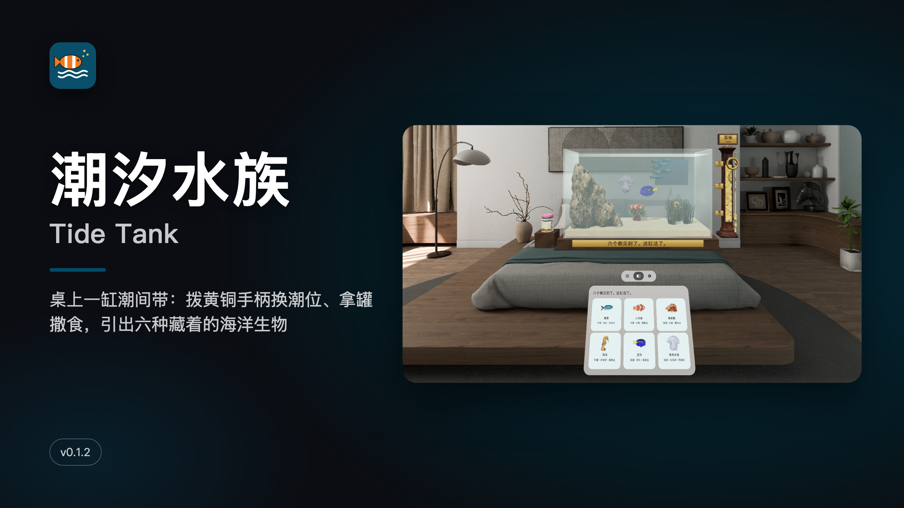
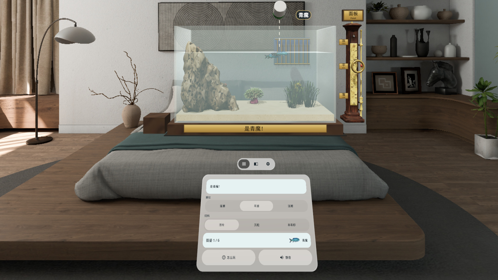
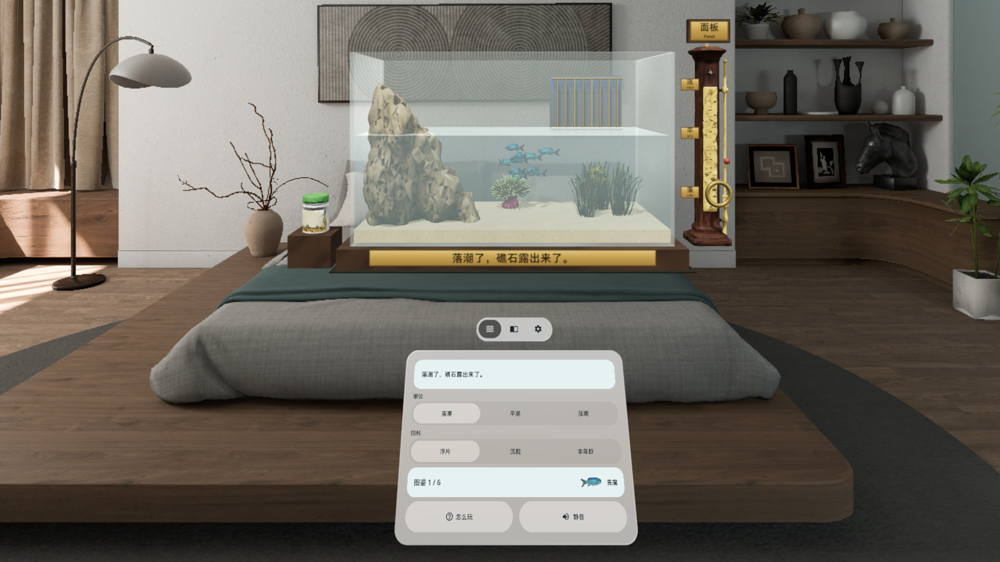
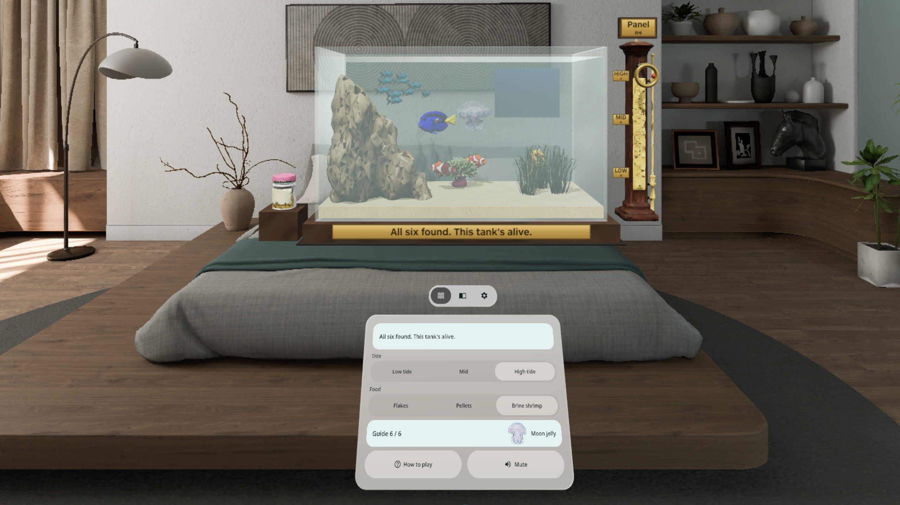
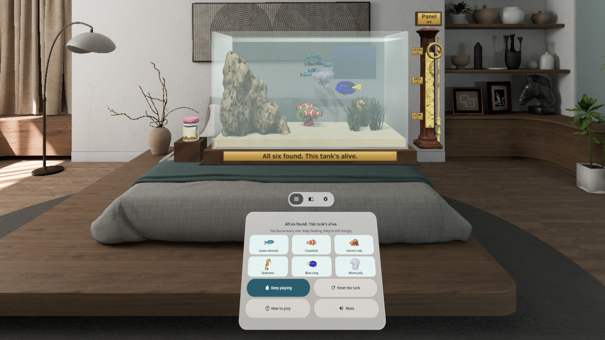

# 潮汐水族 Tide Tank

[中文](#中文) · [English](#english)



## 中文

桌上一只海水缸，放在 PICO OS 6 Shared Space 的系统立体窗口（体积）里。拿起饲料罐移到水面上，饲料一路撒下去，鱼群追着抢；也可以直接点沙底撒一小撮。拖黄铜潮位手柄（落 / 平 / 涨三档吸附）或点刻度牌换潮位：落潮礁石露出水面，涨满潮外海的闸门打开。换着饲料和潮位，把缸里藏着的 6 种海洋生物一个个引出来，图鉴记下见过的。

- 体积 1.19 × 0.78 × 0.64 m（缸 0.84 m 宽）+ 缸正下方的控制窗（600 × 440 dp，原生 TabBar：水缸 / 图鉴 / 设置）
- 三种饲料（浮片 / 沉粒 / 丰年虾）、三档潮位；青魔、小丑鱼、寄居蟹、海马、蓝吊、海月水母各有出场条件
- 手势捏合、眼动 + 捏合、手柄射线；静音、三档音量、水泵声、减少动态、重开控制窗、重置、退出
- 中英双语，全部本机运行，不联网、不需要账号

| | |
|---|---|
|  六个都见到了，图鉴 6/6 |  拿起饲料罐，虚线标出落点 |
|  撒浮片，青魔冲上来抢食 |  平潮 → 落潮，礁石露出水面 |
|  往海葵边撒沉粒，小丑鱼出来了 |  图鉴详情：海马 |

截图来自 PICO 模拟器（v0.1.2，QA #3）。演示视频是模拟器调试指令驱动的录屏，**非真实手势录像**，没有声音。

### 安装

从 [Release v0.1.2](https://github.com/kejing-dev/TideTank/releases/tag/v0.1.2) 下载 `TideTank-v0.1.2.apk`（`assembleRelease` 未签名包，供 Vibe Lab 平台签名；自己装到头显请用本地 `./gradlew assembleDebug` 的包）：

```
adb install -r TideTank-v0.1.2.apk
pico-cli app launch io.embodit.tidetank
```

### 已知问题

- 控制窗在缸下方，窗中心在视线下约 30°（系统摆位限制）
- 坐着打开时系统仍按站姿高度摆缸，缸心在视线上方约 13°
- 模拟器上换应用后的第一次冷启动偶尔要 8–21 秒（之后约 1 秒，判断为模拟器预热；头显未测）

## English

A reef tank on your desk, in a PICO OS 6 Shared Space volume. Lift the food jar over the water and food trails down while
the school chases it, or tap the sand for a pinch. Drag the brass tide handle (snaps to low / mid / high) or tap a gauge
plate: low tide bares the rocks, high tide opens the sea gate. Mix food and tide to coax out six hidden creatures and fill
the guide.

- Volume 1.19 x 0.78 x 0.64 m (tank 0.84 m wide) + a control window right under the tank (600 x 440 dp, native TabBar:
  Tank / Guide / Settings)
- Three foods (flakes / pellets / brine shrimp), three tides; chromis, clownfish, hermit crab, seahorse, blue tang and moon
  jelly each have their own conditions
- Hand pinch, gaze + pinch, controller ray; mute, volume, pump hum, reduce motion, reopen controls, reset, quit
- Chinese and English; fully offline, no account

| | |
|---|---|
|  All six found |  Mid tide, controls under the tank |
|  All-found card |  Settings |

Screenshots are from the PICO emulator (v0.1.2). The demo video is driven by emulator debug input: **not a recording of
real hand gestures**, and silent.

### Install

Download `TideTank-v0.1.2.apk` from [Release v0.1.2](https://github.com/kejing-dev/TideTank/releases/tag/v0.1.2) (unsigned
`assembleRelease` build for platform signing; for your own headset build `./gradlew assembleDebug`):

```
adb install -r TideTank-v0.1.2.apk
pico-cli app launch io.embodit.tidetank
```

### Known issues

- The control window sits under the tank, its centre about 30 deg below eye level (system placement)
- Opened seated, the tank is still placed at standing height (centre about 13 deg above the eyes)
- On the emulator the first cold start after switching apps can take 8-21 s (about 1 s afterwards; not measured on a headset)

## Build / credits

Build: see `AGENTS.md`. Package `io.embodit.tidetank`, PICO Spatial SDK 6.1.9, minSdk 35.

Third-party: 3D creatures and props generated with Tripo (the developer's account), decimated / calibrated by
`tools/build_models.py`; sounds are CC0 recordings (freesound.org, Kenney) listed in `tools/make_sounds.py`; Noto Sans (OFL);
Material Symbols (Apache-2.0).
